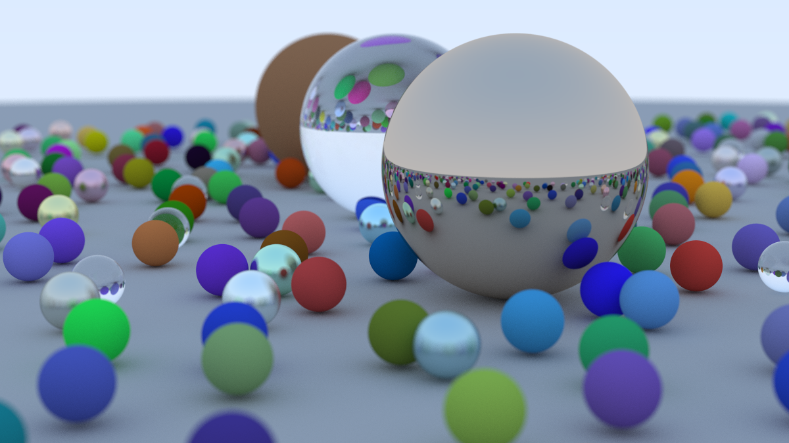
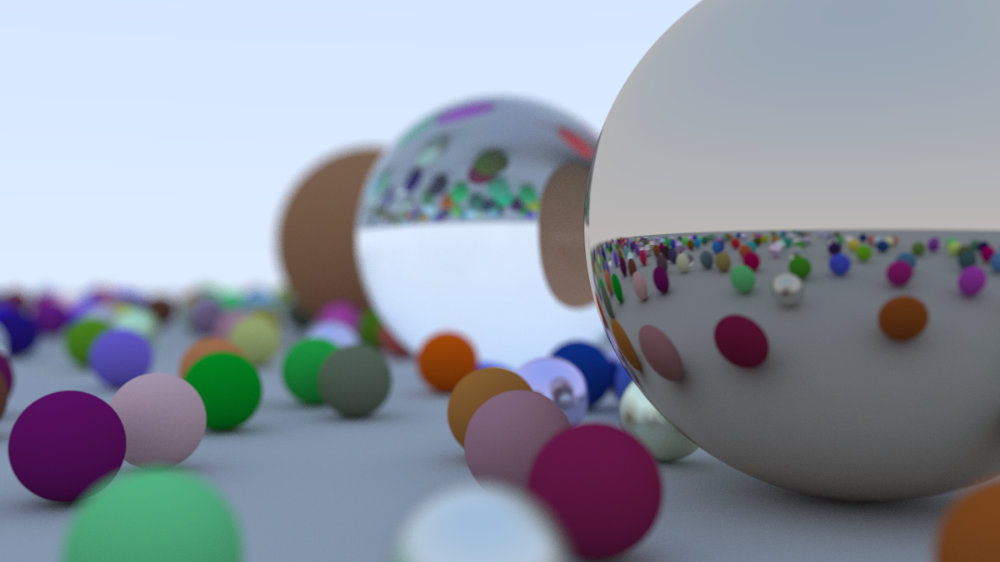
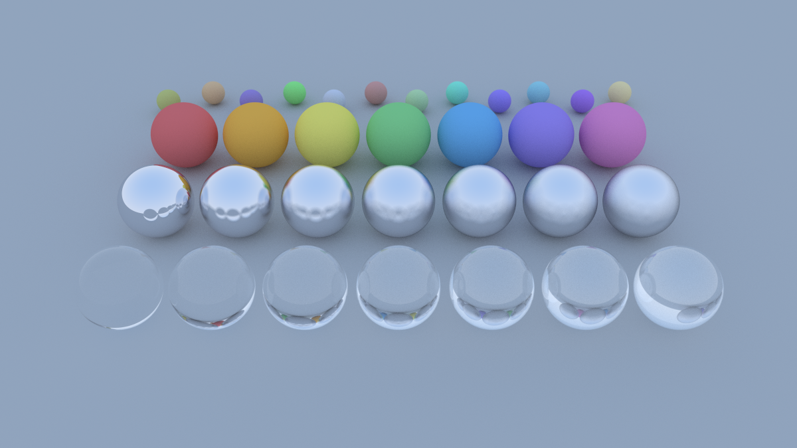
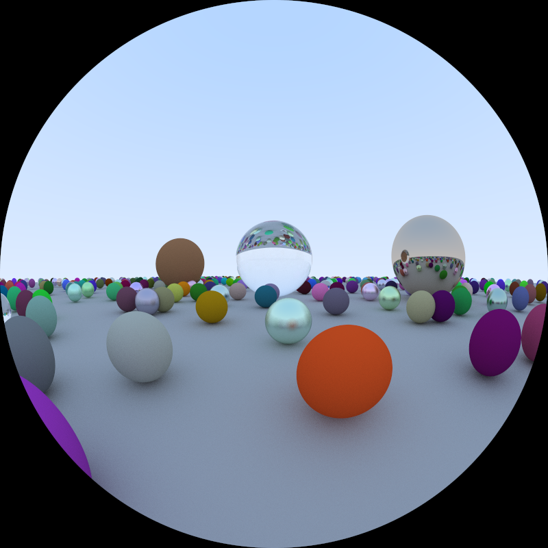

# Ray Tracer

A multithreaded CPU path tracer in C++20 with diffuse, metal and glass materials, depth of field and a fisheye camera mode.

<p align="center">
  
</p>
<p align="center"><em>The scene in <code>src/main.cpp</code>: nearly 500 random diffuse, metal and glass spheres with defocus blur. 1200×675, 500 samples per pixel, 50 bounces.</em></p>

<table>
  <tr>
    <td width="50%"></td>
    <td width="50%"></td>
  </tr>
  <tr>
    <td><em>Same scene from a low angle, focused on the mirror sphere with a wide aperture for strong depth of field.</em></td>
    <td><em>Material study. Back row: diffuse colours. Middle: metal with fuzz rising from 0 to 0.5. Front: glass with refractive index rising from 1.25 to 2.75.</em></td>
  </tr>
</table>

<p align="center">
  
</p>
<p align="center"><em>180° fisheye camera (<code>cam.fisheye = true</code>), 800×800.</em></p>

Look further into negative or positive z axis for viewing direction towards the viewport

## Build & run

```bash
g++ -std=c++20 -O2 -pthread src/main.cpp -o src/main
cd src && ./main
```

The image is written to `data/output.ppm`. Rendering uses every CPU core by default; set `cam.num_threads` in `main.cpp` to change that.
